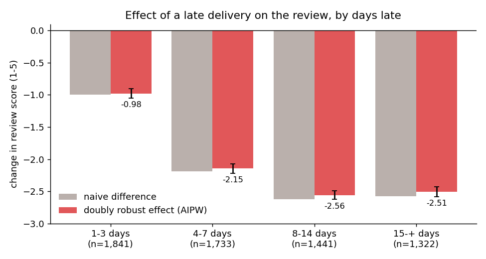
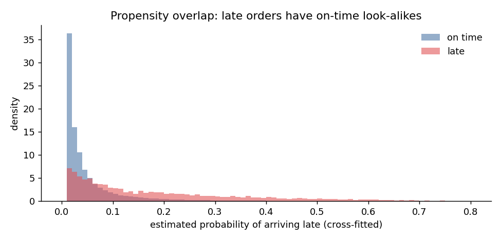
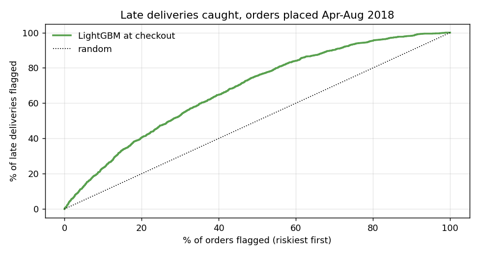

[English ] | [[Español](README.es.md) ]

# What does a late delivery cost an e-commerce marketplace?


96,470 real delivered orders from Olist, a Brazilian marketplace (2016-2018), joined across
nine tables: customers, sellers, items, products, payments, reviews and geolocation. Three
questions, each answered with the method it needs:

1. **How much does a late delivery lower the review score?** A causal question: late orders
   differ from on-time ones before anything goes wrong.
2. **Can we tell at checkout which orders will be late?** A prediction question, validated on
   later months.
3. **Does a late first order stop the customer from coming back?** A survival question.

## Results at a glance

| Question | Answer |
|---|---|
| Effect of arriving late on the review (1-5) | **-1.97 points** (95% CI -2.02 to -1.93), doubly robust |
| ... 1-3 days late | -0.98 |
| ... 4-7 days late | -2.15 |
| ... 8+ days late | about -2.5, no further damage |
| Late deliveries flagged by the riskiest 10% of orders at checkout | 23% (random: 10%), AUC 0.69 |
| Effect of a late first order on buying again within 180 days | -0.4 pp (95% CI -1.0 to +0.2): not detectable |

## 1. Effect of a late delivery on the review

6.8% of orders arrive after the promised date. Their average review is 2.27 against 4.29 for
on-time orders, and 54% of them get one star. But late orders ship farther, go to some states
more than others, carry more items and cluster around peak dates, all of which could lower
scores on their own. Four estimators, from naive to doubly robust, for the effect on the late
orders (ATT):

| Estimator | Effect on review score |
|---|---|
| Naive difference in means | -2.02 |
| OLS with all purchase-time covariates | -1.98 |
| Inverse propensity weighting | -1.97 |
| **AIPW, 5-fold cross-fitted LightGBM** | **-1.97** (SE 0.022) |

Covariates: customer and seller state, seller-customer distance, promised delivery window,
price, freight, weight, number of items and sellers, product category, purchase month and
weekday, and the seller's prior order count.

**Adjusting barely moves the estimate.** What makes late orders different explains almost none
of the drop in score; nearly all of it is the delay itself.

**It would take a very strong hidden confounder to explain it away.** Following Cinelli & Hazlett
(2020), an unobserved variable would need to explain 27% of the residual variance of both
lateness and the review score to bring the effect to zero. The strongest observed covariate,
the promised delivery window, explains 1.1% of lateness and 0.1% of the score.



**The damage is front-loaded.** One to three days late costs about one point; a week late costs
more than two; beyond that the score has nowhere left to go.



Late orders have on-time look-alikes across the propensity range, so the comparison is not
extrapolating. Propensities are clipped at 1% and 99%.

### A trap worth naming: filtering to post-delivery reviews

The obvious cleaning step, dropping reviews written before the parcel arrived, is wrong here.
Olist emails the survey when the product arrives *or* when the promised date passes. For late
orders that means the survey usually comes before the parcel: **74% of late orders were reviewed
before delivery**, by customers who already knew the order was late. Filtering them out keeps
only 1,621 of 6,337 late orders and caps lateness at 8 days, so the analysis would mostly
measure mild delays.

## 2. Predicting late deliveries at checkout

Only information available at purchase is used. The seller's track record is the share of their
earlier orders that had *already been delivered* late when this order was placed, shrunk toward
the overall rate. Fit on orders up to March 2018, scored on April-August 2018:

| Model | AUC | PR-AUC | Late orders in riskiest 10% | in riskiest 20% |
|---|---|---|---|---|
| Late rate of the customer's state | 0.56 | 0.056 | 13% | 31% |
| Logistic regression | 0.67 | 0.082 | 21% | 37% |
| **LightGBM** | **0.69** | **0.086** | **23%** | **40%** |



The signal is real but modest: most delays come from events that do not exist at checkout.
The late rate also fell from 7.9% in the training period to 4.4% in the test period, which is why
the split is by time. The most useful inputs are the customer's state, the seller's track record,
the category and the promised window. In practice the model is a triage list (whom to warn, which
shipments to upgrade) rather than a guarantee.

## 3. Does a late first order lose the customer?

Only 3.0% of Olist customers ever order again, so this question has little data to work with.
Using first orders only:

- Cox model on time to the second order: hazard ratio 0.90 (95% CI 0.78-1.03, p = 0.12).
- AIPW on buying again within 180 days (customers with a full 180-day window): 3.1% after an
  on-time first order, 2.6% after a late one; adjusted effect -0.4 points (95% CI -1.0 to +0.2).

The point estimates lean toward late orders losing customers, but the data cannot distinguish
that from no effect. A real effect smaller than about one percentage point (roughly 30% in
relative terms) would go undetected.

## Method

```
9 Olist tables ──► one row per delivered order (data.py)
   │   confounders known at purchase · treatment (late, days late) · outcomes
   │
   ├── causal.py     naive · OLS · IPW · AIPW (cross-fitted LightGBM), dose-response by
   │                 lateness band, overlap check, Cinelli-Hazlett robustness value
   ├── risk.py       temporal split, seller track record without look-ahead,
   │                 state-rate baseline vs logistic vs LightGBM
   └── retention.py  first orders only: Cox PH on time to next order, AIPW on 180-day return
```

## Data

[Brazilian E-Commerce Public Dataset by Olist](https://www.kaggle.com/datasets/olistbr/brazilian-ecommerce),
Kaggle, license **CC BY-NC-SA 4.0**. Real anonymised commercial data. Downloaded October 2026;
not redistributed in this repository.

## Reproduce

```powershell
python -m venv venv
.\venv\Scripts\python.exe -m pip install -r requirements.txt
$env:PYTHONPATH = "src"
python -m olist.data        # downloads with ~/.kaggle/kaggle.json, builds data/orders.parquet
python -m olist.causal      # ~3 min
python -m olist.risk
python -m olist.retention
python -m olist.figures
pytest -q tests
```

## Limitations

- "Late" is measured against Olist's own promise. A conservative promise would hide delays that
  customers still feel.
- Review timing is used as recorded; a few orders have more than one review, and the last answered
  one is kept.
- No-unmeasured-confounding is an assumption. The sensitivity analysis bounds it, but cannot
  rule out, for example, a product-quality problem that also slows shipping.

## License

Code: MIT. Data: CC BY-NC-SA 4.0, Olist (not redistributed).
